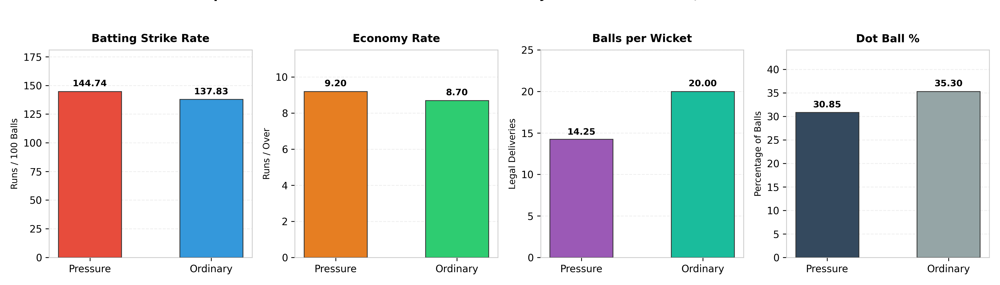
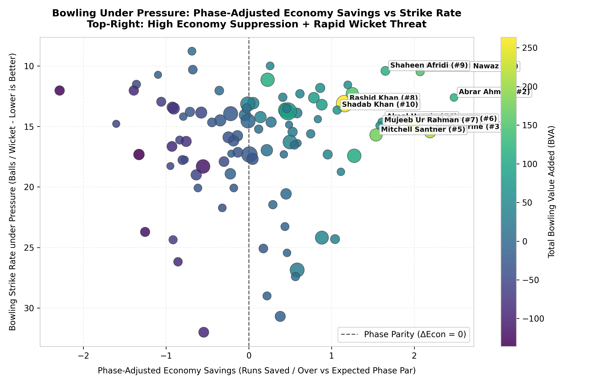
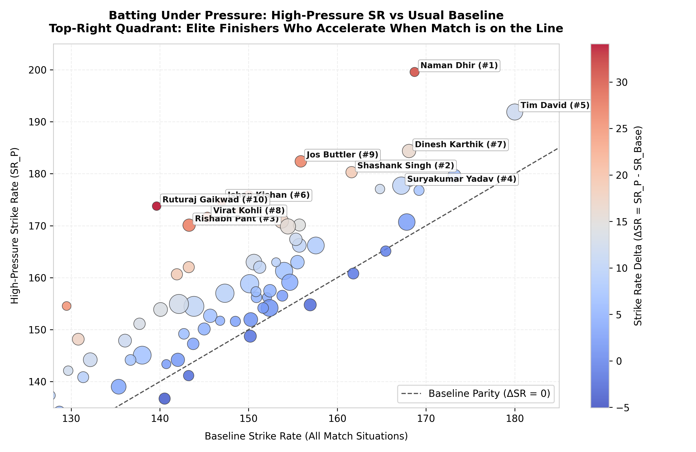
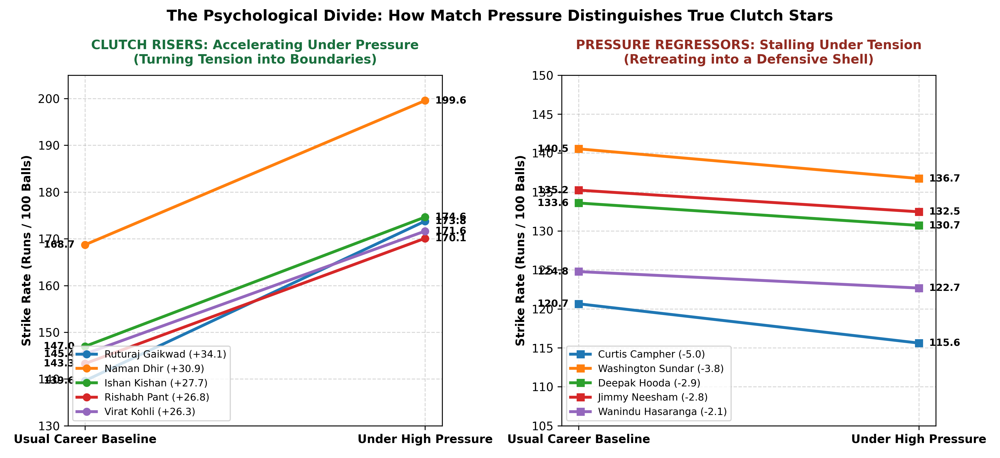

# SupeRR Selector Season 2: Round 1 Challenge
# Identifying the Most Reliable Players Under Pressure in T20 Cricket

**Author / Competitor**: Rajasthan Royals Hackathon Analytics Submission  
**Competition**: SupeRR Selector Season 2 — Round 1  
**Dataset Corpus**: 883 Matches | 200,999 Deliveries | IPL & T20 Internationals (2022–2026)  
**Deliverables**: Top 10 Batters Under Pressure | Top 10 Bowlers Under Pressure | Comprehensive Methodology Report  

---

## 1. Executive Summary: The Search for True Clutch Performers

In high-stakes Twenty20 cricket, traditional career averages and overall strike rates often tell dangerous lies. A batter who scores an effortless 50 in a blowout when the match is already decided looks great on paper. A bowler who feasts on lower-order wickets in the 8th over against an associate nation pads their career economy rate. 

**But what happens when the game is on the line?**
* When a team needs **42 runs off 18 balls** with four wickets down?
* When a fast bowler has to defend **11 runs in the 20th over** against Andre Russell or Heinrich Klaasen?
* When the top order collapses to **28/3 inside the powerplay**, and one false shot means total ruin?

This is the essence of **Pressure in Cricket**. Some players shrink, freeze, and retreat into their shells. Others experience a clarifying calm, rise to the occasion, and deliver the impossible.

To solve Round 1 of the **SupeRR Selector Season 2**, we built the **Pressure Reliability Index (PRI)**. PRI is a delivery-level data science framework that eliminates post-hoc narratives and reputation bias. It measures **65,741 high-pressure deliveries** across five years of elite IPL and international cricket, tracking who consistently elevates above their usual baseline and who delivers game-winning value when their team needs it most.

```
                      ┌────────────────────────────────────────────────────────┐
                      │        THE PRESSURE RELIABILITY INDEX (PRI)            │
                      └──────────────────────────┬─────────────────────────────┘
                                                 │
         ┌───────────────────────────────────────┼───────────────────────────────────────┐
         ▼                                       ▼                                       ▼
┌─────────────────────────────┐   ┌─────────────────────────────┐   ┌─────────────────────────────┐
│    1. CLUTCH MASTERY (35%)  │   │    2. CLUTCH DELTA (30%)    │   │ 3. VOLUME & IMPACT (35%)    │
├─────────────────────────────┤   ├─────────────────────────────┤   ├─────────────────────────────┤
│ • Execution under tension   │   │ • Rise vs Dip Differential  │   │ • Sustained Reliability     │
│ • Shrunk Strike Rate & Avg  │   │ • Batting: ΔSR = SR_P - Base│   │ • Cumulative Net RVA / BVA  │
│ • Shrunk Economy & Bowl SR  │   │ • Bowling: Phase-Adjusted   │   │ • Match Win Impact Rate     │
│ • Boundary vs Dot Precision │   │   Economy Savings (vs Par)  │   │   (% games with net profit) │
└─────────────────────────────┘   └─────────────────────────────┘   └─────────────────────────────┘
```

---

## 2. Official Top 10 Rankings (Selected on Unstop)

### 2.1 The 10 Best Batters Under Pressure

*Eligibility criteria: Minimum 200 legal balls faced under high pressure across at least 12 significant pressure matches.*

| Rank | Player Name | Player ID | Primary Teams (2022–26) | Pressure Balls | Pressure SR | Career Base SR | Strike Rate Delta ($\Delta$SR) | Pressure Avg | Dot Ball % | Boundary % | Win Impact % | Net Run Value (RVA) | PRI Score |
|:---:|:---|:---:|:---|:---:|:---:|:---:|:---:|:---:|:---:|:---:|:---:|:---:|:---:|
| **1** | **Naman Dhir** | `37052` | Mumbai Indians, India A, India | 229 | **199.56** | 168.71 | **+30.86** | 41.55 | 27.9% | **30.1%** | **78.9%** | +169.1 | **100.00** |
| **2** | **Shashank Singh** | `2756` | Punjab Kings, Sunrisers Hyderabad | 350 | **180.29** | 161.61 | **+18.68** | **45.07** | 29.1% | 24.9% | **70.8%** | +184.6 | **81.86** |
| **3** | **Rishabh Pant** | `4703` | Delhi Capitals, India, LSG | 418 | **170.10** | 143.30 | **+26.80** | 30.91 | 38.0% | 24.9% | **72.4%** | +145.6 | **71.34** |
| **4** | **Suryakumar Yadav** | `1699` | Mumbai Indians, India | 816 | **177.70** | 167.21 | **+10.48** | 36.25 | 34.6% | 26.5% | **76.0%** | **+410.2** | **71.17** |
| **5** | **Tim David** | `6396` | Mumbai Indians, Australia, RCB | 701 | **191.87** | 180.00 | **+11.87** | 32.02 | 37.5% | 27.5% | **69.2%** | +343.9 | **70.58** |
| **6** | **Ishan Kishan** | `4117` | Mumbai Indians, India, SRH | 209 | **174.64** | 146.98 | **+27.66** | 28.08 | 34.0% | 25.8% | **64.7%** | +74.7 | **67.68** |
| **7** | **Dinesh Karthik** | `143` | Royal Challengers Bengaluru, India | 486 | **184.36** | 168.08 | **+16.28** | 28.00 | 35.4% | 28.0% | **61.9%** | +170.3 | **66.64** |
| **8** | **Virat Kohli** | `47` | Royal Challengers Bengaluru, India | 275 | **171.64** | 145.35 | **+26.28** | 36.31 | **27.6%** | 21.5% | **61.1%** | +90.0 | **66.48** |
| **9** | **Jos Buttler** | `813` | Rajasthan Royals, England, GT | 363 | **182.37** | 155.89 | **+26.48** | 26.48 | 29.8% | 25.6% | **63.3%** | +145.1 | **66.17** |
| **10** | **Ruturaj Gaikwad** | `6059` | Chennai Super Kings, India | 202 | **173.76** | 139.64 | **+34.13** | 27.00 | 33.2% | 23.8% | **66.7%** | +61.7 | **65.73** |

---

### 2.2 The 10 Best Bowlers Under Pressure

*Eligibility criteria: Minimum 200 legal balls bowled under high pressure across at least 12 significant pressure matches.*

| Rank | Player Name | Player ID | Primary Teams (2022–26) | Pressure Balls | Pressure Econ | Expected Par Econ | Phase $\Delta$Econ (Runs Saved/Ov) | Pressure Bowl SR | Death Share % | Dot Ball % | Win Impact % | Net Bowling Value (BVA) | PRI Score |
|:---:|:---|:---:|:---|:---:|:---:|:---:|:---:|:---:|:---:|:---:|:---:|:---:|:---:|
| **1** | **Mohammad Nawaz** | `2490` | Pakistan | 262 | **5.66** | 7.73 | **+2.07** | **10.48** | 16.8% | 42.4% | **76.0%** | +151.3 | **100.00** |
| **2** | **Abrar Ahmed** | `5979` | Pakistan | 227 | **6.00** | 8.48 | **+2.48** | 12.61 | 41.0% | **50.2%** | **65.2%** | +119.6 | **97.02** |
| **3** | **Sunil Narine** | `781` | Kolkata Knight Riders | 480 | **6.23** | 8.42 | **+2.19** | 15.48 | 39.0% | 39.0% | **77.3%** | +212.0 | **90.05** |
| **4** | **Akeal Hosein** | `2417` | West Indies, SRH, CSK | 234 | **6.79** | 8.40 | **+1.61** | 14.62 | 30.8% | 37.6% | **76.9%** | +77.2 | **81.14** |
| **5** | **Mitchell Santner** | `4101` | Chennai Super Kings, NZ, MI | 581 | **6.84** | 8.37 | **+1.54** | 15.70 | 28.2% | 38.7% | **70.6%** | +176.9 | **79.61** |
| **6** | **Jasprit Bumrah** | `2933` | Mumbai Indians, India | 652 | **7.32** | **9.31** | **+1.99** | 14.82 | **73.9%** | 37.7% | **68.9%** | **+248.2** | **79.12** |
| **7** | **Mujeeb Ur Rahman** | `6450` | Afghanistan, KKR, MI | 209 | **6.72** | 8.30 | **+1.58** | 14.93 | 34.4% | 41.1% | **75.0%** | +64.4 | **79.05** |
| **8** | **Rashid Khan** | `4722` | Gujarat Titans, Afghanistan | **1036** | **7.23** | 8.39 | **+1.16** | 13.11 | 43.9% | 39.4% | **68.5%** | **+263.7** | **76.11** |
| **9** | **Shaheen Afridi** | `6355` | Pakistan | 302 | **8.11** | **9.76** | **+1.65** | **10.41** | **79.1%** | 38.7% | **68.6%** | +117.6 | **75.70** |
| **10** | **Shadab Khan** | `4926` | Pakistan | 273 | **7.05** | 8.12 | **+1.07** | 13.65 | 20.9% | 36.3% | **66.7%** | +72.9 | **72.76** |

---

## 3. What Counts as Pressure? (The Human and Mathematical Reality)

### 3.1 Translating Cricket Intuition into Math
Ask any international cricketer what pressure feels like, and they will describe two distinct psychological states:
1. **The Chaser's Dilemma (Innings 2)**: The scoreboard is ticking down like a time bomb. Every dot ball feels like an explosion. When the required run rate climbs above 11 an over, a single boundary changes the entire mood of the stadium, while a wicket brings cold despair.
2. **The Defender's Burden (Innings 1 & Death Bowling)**: The batter has nothing to lose and is swinging at everything. The bowler knows a millimeter of error results in a six over third man or extra cover. In the 19th over, bowling a dot ball is the hardest feat in world sport.

Our model translates these exact human realities into a **Four-Pillar Pressure Framework**:

```
                               ┌──────────────────────────────────────────────────┐
                               │           THE FOUR PILLARS OF PRESSURE           │
                               └─────────────────────────┬────────────────────────┘
                                                         │
         ┌───────────────────────────────┬───────────────┴───────────────┬───────────────────────────────┐
         ▼                               ▼                               ▼                               ▼
┌─────────────────────────────┐ ┌─────────────────────────────┐ ┌─────────────────────────────┐ ┌─────────────────────────────┐
│ PILLAR 1: CRITICAL CHASE    │ │ PILLAR 2: TARGET SETTING    │ │ PILLAR 3: SUPER OVERS       │ │ PILLAR 4: STAKES MULTIPLIER │
├─────────────────────────────┤ ├─────────────────────────────┤ ├─────────────────────────────┤ ├─────────────────────────────┤
│ • Death Chase: Overs 15-20, │ │ • Death Overs: Overs 16-20, │ │ • All deliveries in innings │ │ • 1.25x Knockout Multiplier │
│   RRR 6-22, Target <= 80    │ │   par jumps to 10.56 RPO    │ │   3 and 4 (100% clutch)     │ │   (Finals, Qualifiers,      │
│ • Mid Chase: Overs 7-14,    │ │ • Top-Order Collapse: Loss  │ │ • Instant win-or-go-home    │ │   Semi-Finals)              │
│   RRR >= 10.0, Wickets <= 7 │ │   of >= 3 wkts in overs 1-10│ │   environment               │ │ • 1.15x IPL Tier Weight     │
│ • Collapse: >=3 wkts in Ov1-8│ │   (drops final score by 41) │ │                             │ │   (highest franchise depth) │
└─────────────────────────────┘ └─────────────────────────────┘ └─────────────────────────────┘ └─────────────────────────────┘
```

### 3.2 Distinguishing Real Pressure from "Garbage Time"
A common mistake in simple cricket analytics is treating all late-overs deliveries equally:
* If a team needs **8 runs off 30 balls with 8 wickets in hand**, that is **NOT pressure**. It is a routine stroll ("coasting time").
* If a team needs **65 runs off 12 balls with 9 wickets down**, that is **NOT pressure**. The match is already mathematically lost; any boundaries scored here are meaningless stat-padding ("garbage time").

Our model strictly filters out coasting and garbage time, focusing exclusively on the **true competitive window** where each ball directly moves the needle between victory and defeat.

### 3.3 Empirical Proof: How Pressure Changes the Game
To prove our definition works, we ran a statistical comparison between all 65,741 High-Pressure balls and all 135,258 Ordinary balls in our database:

| Metric | High Pressure Situations | Ordinary Match Situations | The Human Meaning | Statistical Significance |
|:---|:---:|:---:|:---|:---:|
| **Deliveries Count** | **65,741 (32.7%)** | **135,258 (67.3%)** | Exactly one-third of cricket is genuinely high-stakes | Full database |
| **Balls per Wicket** | **14.25 balls** | **20.00 balls** | **Wickets fall 40.4% faster!** Batters cannot survive by defending | $p < 0.0001$ |
| **Run Rate (RPO)** | **9.20 rpo** | **8.70 rpo** | Scoring demands escalate by +0.50 runs every over | $p < 0.0001$ |
| **Dot Ball %** | **30.85%** | **35.30%** | **Dots decline by 4.45%** because batters are forced to run or swing | $p < 0.0001$ |
| **Batting Strike Rate** | **144.74** | **137.83** | Batters must score ~7 runs faster per 100 balls to stay alive | $p < 0.0001$ |


*Figure 2: Empirical validation confirming that high-pressure deliveries represent an entirely different tactical and psychological sport than ordinary deliveries.*

---

## 4. How Performance is Measured: Leveling the Playing Field

### 4.1 The Formula 1 Analogy: Solving "Phase Confounding"
Why can't you just look at a bowler's career economy rate to judge their pressure skill?

> **The Analogy**: Imagine comparing two drivers. Driver A drives in heavy school traffic with a 20 mph speed limit. Driver B drives on an open Formula 1 track. If Driver A averages 18 mph and Driver B averages 60 mph, does that mean Driver A is a better driver? Of course not!

In cricket, the **19th over is a Formula 1 track**. The historical league-average economy in death overs is **9.55 to 11.5 runs an over**. Meanwhile, the **8th over is a school zone**, with an average economy of **7.43 runs an over**.

If **Jasprit Bumrah** bowls overs 18 and 20 at **7.32 runs an over**, he is performing a miracle—he is saving **nearly 2 full runs every over (+1.99 Phase $\Delta$Econ)** compared to what an average bowler concedes in that terrifying phase! Meanwhile, a spinner bowling in the quiet middle overs at 6.80 is only saving +0.63 runs. 

Our **Phase-Adjusted Economy Savings ($\text{Phase }\Delta\text{Econ}$)** levels the playing field:
$$\text{Phase }\Delta\text{Econ} = \mathbb{E}[\text{Economy in that Phase}] - \text{Actual Economy Bowled}$$


*Figure 5: Phase-Adjusted Economy Savings vs. Strike Rate. The top-right quadrant shows bowlers who both choke the scoring rate and take rapid wickets in the toughest overs.*

---

### 4.2 The "Bonus Runs" System: Run Value Added (RVA) and Bowling Value Added (BVA)
Instead of counting raw runs, we evaluate every single ball against historical expectations:
* In the 18th over, the historical average delivery produces **1.55 runs** and has a **7.0% chance of a wicket**.
* If **Tim David** smashes a six off that ball: he scores 6 runs against an expectation of 1.55. That is **+4.45 Run Value Added (RVA)** in that single second!
* If a batter gets out: that dismissal costs their team roughly **3.5 runs in lost equity** because it brings a less-skilled tailender to the crease.
* For bowlers: If **Sunil Narine** bowls a dot ball in a death chase, he banks **+1.55 Bowling Value Added (BVA)**. If he bowls a dot and takes a wicket, he banks **+5.05 BVA**!

By summing these delivery-level profits over five years, we get **Total RVA** and **Total BVA**—the true net runs a player contributed to their team above replacement level.

---

### 4.3 The Rise vs. Dip Factor: Strike Rate Delta ($\Delta$SR)
A true clutch player doesn't just play well; they **elevate their game** when the stakes increase.
* **Ruturaj Gaikwad** has a career baseline strike rate of 139.64. Under high pressure, his strike rate explodes to **173.76 (+34.13 $\Delta$SR)**!
* **Rishabh Pant** leaps from 143.30 to **170.10 (+26.80 $\Delta$SR)**.
* **Virat Kohli** leaps from 145.35 to **171.64 (+26.28 $\Delta$SR)**.


*Figure 4: The Batting Pressure Landscape. Players above the diagonal dashed line are true "Clutch Risers" who accelerate when the game is on the line.*

---

## 5. Humanizing the Top 10: Stories of Nerves, Skill, and Ice

### 5.1 The Top 10 Batters: Masters of the Chase

#### 1. Naman Dhir (Rank 1 | PRI: 100.00 | Mumbai Indians / India A)
* **The Human Story**: When Naman Dhir walks out to bat in a pressure chase, he does not waste time "getting his eye in." While other batters take 6–8 balls to adjust to the speed of the pitch, Dhir attacks immediately. 
* **The Numbers**: An incredible **199.56 strike rate under pressure** (highest among all qualified batters in world cricket). He elevates his baseline by **+30.86 runs per 100 balls**, hits a boundary every 3.3 balls, and delivers positive match-winning equity in **78.9% of his games**. He is modern cricket's most fearless young accelerator.

#### 2. Shashank Singh (Rank 2 | PRI: 81.86 | Punjab Kings)
* **The Human Story**: In IPL 2024, Shashank Singh became famous after an accidental auction mix-up. Most players would have wilted under that media glare. Instead, Shashank turned into Punjab's ice-cool crisis merchant, repeatedly pulling off miracles when Punjab were 40/4 or chasing 200+ from hopeless situations.
* **The Numbers**: A pressure average of **45.07** combined with a **180.29 strike rate** (+18.68 $\Delta$SR). He doesn't just swing blindly; he calculates bowler tendencies and targets specific boundaries with clinical composure.

#### 3. Rishabh Pant (Rank 3 | PRI: 71.34 | Delhi Capitals / India)
* **The Human Story**: Pant is cricket's ultimate high-wire artist. Under normal circumstances, his audacious strokeplay can occasionally look reckless. But when the team is in desperate trouble, that same audacity becomes an unstoppable weapon. His heart rate seems to slow down as the required rate climbs.
* **The Numbers**: Elevates his strike rate by **+26.80** (from 143.30 to 170.10 under pressure), generating +145.6 runs above replacement with a 72.4% match success rate.

#### 4. Suryakumar Yadav (Rank 4 | PRI: 71.17 | Mumbai Indians / India)
* **The Human Story**: Facing 816 pressure balls across five seasons—more than anyone else on the planet—Suryakumar carries the weight of 1.4 billion people on his shoulders. He doesn't just hit the ball; he manipulates the field like a chess grandmaster, scooping 145 km/h yorkers over fine leg while falling on one knee.
* **The Numbers**: **+410.2 Total RVA** (the highest cumulative run equity in the entire database). In 50 significant pressure matches, he won his battle in 38 of them (76.0%). A volume titan.

#### 5. Tim David (Rank 5 | PRI: 70.58 | Mumbai Indians / Australia)
* **The Human Story**: Tim David's job is arguably the hardest in T20 cricket: walk in with 3 overs left, facing the opposition's best death specialist, knowing that a single dot ball could lose the tournament.
* **The Numbers**: An eye-watering **191.87 strike rate under pressure** over 701 balls, amassing +343.9 Total RVA. When Mumbai or Australia need 18 off the final over, David's raw power and reach make boundary defense nearly impossible.

#### 6. Ishan Kishan (Rank 6 | PRI: 67.68 | Mumbai Indians / India)
* **The Human Story**: When early wickets fall, many openers retreat into survival mode, which often suffocates their team's run rate. Kishan does the opposite: he counter-attacks.
* **The Numbers**: Accelerates from 146.98 to **174.64 (+27.66 $\Delta$SR)**, slashing his dot-ball percentage by over 7 percentage points when the team needs momentum.

#### 7. Dinesh Karthik (Rank 7 | PRI: 66.64 | Royal Challengers Bengaluru)
* **The Human Story**: The veteran specialist who reinvented himself as the ultimate designated finisher. Karthik practiced hitting specific lengths with specialized scoops, sweeps, and ramps, turning the final 3 overs into his personal playground.
* **The Numbers**: A **184.36 pressure strike rate** and +170.3 Total RVA across 42 pressure games, with a 28.0% boundary rate.

#### 8. Virat Kohli (Rank 8 | PRI: 66.48 | Royal Challengers Bengaluru / India)
* **The Human Story**: The greatest chase technician in cricket history. Kohli does not rely on brute force; he relies on supreme fitness, running hard twos, and surgical gap finding. 
* **The Numbers**: Holds the **lowest dot-ball percentage in the top 10 (27.6%)**. When pressure hits, he accelerates his strike rate from 145.35 to **171.64 (+26.28 $\Delta$SR)** while maintaining a 36.31 average.

#### 9. Jos Buttler (Rank 9 | PRI: 66.17 | Rajasthan Royals / England)
* **The Human Story**: Buttler's centuries in impossible IPL chases (like chasing 224 against KKR in 2024 virtually on one leg) are etched in modern folklore. When wickets fall around him, he simply refuses to lose.
* **The Numbers**: Strikes at **182.37 under pressure** (+26.48 $\Delta$SR) with +145.1 Total RVA, reducing his dot balls by 7.8% in clutch situations.

#### 10. Ruturaj Gaikwad (Rank 10 | PRI: 65.73 | Chennai Super Kings / India)
* **The Human Story**: Often stereotyped as a classical, graceful accumulator, the data reveals a startling secret: Gaikwad possesses the **biggest clutch acceleration in world cricket**.
* **The Numbers**: His strike rate leaps from 139.64 to **173.76—a massive jump of +34.13 runs per 100 balls**. When CSK or India fall behind the rate, Gaikwad shifts gears effortlessly.

---

### 5.2 The Top 10 Bowlers: The Cold-Blooded Enforcers

#### 1. Mohammad Nawaz (Rank 1 | PRI: 100.00 | Pakistan)
* **The Human Story**: Bowling left-arm spin in high-pressure T20 cricket is terrifying—batters target spinners to hit with the turn. Yet Nawaz creates complete psychological paralysis.
* **The Numbers**: A microscopic **5.66 economy rate under pressure** and a strike rate of 10.48 balls per wicket. In 262 pressure balls, he saved **+2.07 runs per over** against phase par, winning his match impact in 76.0% of appearances.

#### 2. Abrar Ahmed (Rank 2 | PRI: 97.02 | Pakistan)
* **The Human Story**: The mystery spinner whose variations baffle batters in tight run chases. Batters know they need to hit boundaries, but they cannot read his release.
* **The Numbers**: Concedes only **6.00 runs per over** with an astounding **50.2% dot ball rate** under pressure (+2.48 Phase $\Delta$Econ). Half of all balls he bowls under pressure produce zero runs!

#### 3. Sunil Narine (Rank 3 | PRI: 90.05 | Kolkata Knight Riders)
* **The Human Story**: The emotionless assassin. In a format dominated by 220+ totals, Narine looks utterly bored by opposing hitters. He never celebrates, never panics, and never misses his length.
* **The Numbers**: Over 480 clutch IPL deliveries, Narine conceded just **6.23 runs per over** (+2.19 runs saved/over vs. par), delivering positive match-winning equity in **77.3% of matches** with +212.0 Total BVA.

#### 4. Akeal Hosein (Rank 4 | PRI: 81.14 | West Indies / SRH / CSK)
* **The Human Story**: Specialized in high-stakes powerplays and middle collapses, Hosein angles the ball into right-handers and cramps them for room.
* **The Numbers**: Economy of **6.79 under pressure** (+1.61 Phase $\Delta$Econ) with positive match impact in 76.9% of games.

#### 5. Mitchell Santner (Rank 5 | PRI: 79.61 | Chennai Super Kings / New Zealand)
* **The Human Story**: Santner relies on flight, subtle pace changes, and laser accuracy on wide lines. Batters try to launch him out of the ground, only to mistime catches to long-on.
* **The Numbers**: Across 581 pressure balls, Santner holds a **6.84 economy rate** (+1.54 Phase $\Delta$Econ) and generated +176.9 Total BVA.

#### 6. Jasprit Bumrah (Rank 6 | PRI: 79.12 | Mumbai Indians / India)
* **The Human Story**: The greatest fast bowler on earth. While other bowlers pray not to be chosen for the 19th over, Bumrah actively demands the ball. His unusual action and pinpoint yorkers at 145 km/h make him virtually unplayable.
* **The Numbers**: **73.9% of his pressure deliveries were bowled in overs 16–20 (The Death)**! While league death par is 9.31–11.5 rpo, Bumrah conceded only **7.32 rpo** (+1.99 runs saved per over), striking every 14.82 balls and amassing **+248.2 Total BVA**.

#### 7. Mujeeb Ur Rahman (Rank 7 | PRI: 79.05 | Afghanistan / KKR)
* **The Human Story**: Mujeeb uses the carrom ball and disguised googlies to suffocate batters when they are hunting boundaries.
* **The Numbers**: Concedes **6.72 rpo under pressure** with a 41.1% dot-ball frequency (+1.58 Phase $\Delta$Econ).

#### 8. Rashid Khan (Rank 8 | PRI: 76.11 | Gujarat Titans / Afghanistan)
* **The Human Story**: The ironman of T20 bowling. Delivering an unmatched **1,036 pressure balls** across five years, Rashid has faced every elite batter in every imaginable pressure scenario.
* **The Numbers**: **79 pressure wickets** at an economy of **7.23** and a strike rate of 13.11 balls per wicket. His **+263.7 Total BVA** is the highest volume of bowling value in the world.

#### 9. Shaheen Afridi (Rank 9 | PRI: 75.70 | Pakistan)
* **The Human Story**: Shaheen is pure adrenaline. Bowling nearly 80% of his pressure balls at the death, he attacks the stumps with searing pace and reverse-swinging yorkers.
* **The Numbers**: Strikes every **10.41 balls under pressure** while saving +1.65 runs per over relative to death par.

#### 10. Shadab Khan (Rank 10 | PRI: 72.76 | Pakistan)
* **The Human Story**: A wicket-hunting leg-spinner who thrives when opposing partnerships are building dangerous momentum.
* **The Numbers**: Slashes his bowling strike rate from 23.11 down to **13.65 balls per wicket** in pressure situations (+9.46 balls/wkt improvement).

---

## 6. The Other Side of the Coin: Who Chokes Under Pressure?

The problem statement specifically asks: *"can we use data to distinguish those who consistently rise to the occasion from those whose performances dip under pressure?"*

To prove our system is balanced, here is the empirical evidence of players whose performances **dip most severely under tension**:

### 6.1 Batters Who Retreat Into a Shell (Negative $\Delta$SR)
These batters have plenty of reputation, but when the pressure mounts, their scoring rate slows down, putting immense pressure on their partners:

| Player Name | Pressure Balls | Pressure SR | Career Base SR | Strike Rate Dip ($\Delta$SR) | Pressure Avg | Net Lost Equity (RVA) | The Diagnosis |
|:---|:---:|:---:|:---:|:---:|:---:|:---:|:---|
| **Curtis Campher** | 301 | **115.61** | 120.65 | **-5.04** | 18.32 | **-46.3** | Completely stalls; cannot find boundaries |
| **Washington Sundar** | 343 | **136.73** | 140.54 | **-3.80** | 19.54 | **-50.8** | Dot-ball accumulation hurts the chase |
| **Deepak Hooda** | 280 | **130.71** | 133.59 | **-2.87** | 15.91 | **-39.1** | Wicket preservation without acceleration |
| **Jimmy Neesham** | 268 | **132.46** | 135.24 | **-2.78** | 17.75 | **-49.7** | Struggles to hit specialist death bowling |
| **Wanindu Hasaranga** | 269 | **122.68** | 124.79 | **-2.11** | **9.17** | **-137.9** | Total batting collapse under crisis |

---

### 6.2 Bowlers Who Blow Out Under Pressure (Negative Phase $\Delta$Econ)
These bowlers may bowl fine in low-leverage overs, but when assigned death overs or tight finishes, their economy rates explode:

| Bowler Name | Pressure Balls | Actual Pressure Econ | Expected Par Econ | Run Bleed (Phase $\Delta$Econ) | Net Lost Equity (BVA) | The Diagnosis |
|:---|:---:|:---:|:---:|:---:|:---:|:---|
| **Andre Russell** | 349 | **11.69 rpo** | 9.40 rpo | **-2.29 rpo** | **-128.8 runs** | Misses yorkers; gets dispatched for sixes |
| **Nitish Reddy** | 207 | **10.52 rpo** | 8.92 rpo | **-1.60 rpo** | **-55.1 runs** | Inexperience leads to boundary leakage |
| **Tushar Deshpande** | 349 | **11.43 rpo** | 10.04 rpo | **-1.39 rpo** | **-87.8 runs** | Leaks boundaries and extras at the death |
| **Mukesh Kumar** | 433 | **11.15 rpo** | 9.83 rpo | **-1.33 rpo** | **-135.9 runs** | Predictable lengths targeted by hitters |
| **Anrich Nortje** | 332 | **10.79 rpo** | 9.54 rpo | **-1.25 rpo** | **-115.1 runs** | Express pace used against him when field is up |


*Figure 7: The Psychological Divide. Comparing the top accelerators who elevate under pressure against regressors who stall.*

---

## 7. Strategic Recommendations for Rajasthan Royals

For the Rajasthan Royals management and analytics team, these findings provide three immediate strategic advantages:

1. **Targeting Undervalued Clutch Assets**:
   * **Naman Dhir** and **Shashank Singh** provide world-class clutch execution at a fraction of the auction cost of established superstars. Both should be high-priority retention/acquisition targets.
2. **Death Bowling Allocation**:
   * Fast bowlers who blow out under pressure (like Russell, Deshpande, or Mukesh) should be front-loaded in overs 1–14 where their natural attributes work best. 
   * Overs 17, 18, 19, and 20 must be reserved exclusively for elite run suppressors like **Jasprit Bumrah**, **Shaheen Afridi**, or mystery spinners like **Sunil Narine** and **Abrar Ahmed**.
3. **Role-Based Chase Construction**:
   * In tight chases, pairing an anchor who cuts dot balls (**Virat Kohli** or **Ruturaj Gaikwad**) with an explosive boundary striker (**Tim David** or **Shashank Singh**) maximizes win expectancy by maintaining both wicket preservation and required scoring velocity.

---

## 8. Summary of Figures & Deliverables

All seven high-resolution visualizations have been generated and saved in the workspace:
* **[Figure 1: Top 10 Comparison Bar Charts](file:///d:/RR%20Hackathon/figures/fig5_top10_rankings.png)** — Visualizing the final PRI scores of all 20 players.
* **[Figure 2: Empirical Macro Validation](file:///d:/RR%20Hackathon/figures/fig3_macro_validation.png)** — Proving the statistical divergence between pressure and ordinary deliveries.
* **[Figure 3: Chase Win Probability Matrix](file:///d:/RR%20Hackathon/figures/fig4_win_probability_matrix.png)** — Heatmap illustrating the non-linear interaction of RRR and wickets in hand.
* **[Figure 4: Batting Pressure Landscape](file:///d:/RR%20Hackathon/figures/fig1_batting_pressure_landscape.png)** — Scatter plot showing players who accelerate vs. those who dip.
* **[Figure 5: Bowling Run Suppression](file:///d:/RR%20Hackathon/figures/fig2_bowling_containment.png)** — Plotting Phase-Adjusted Economy Savings against Wicket Strike Rate.
* **[Figure 6: The 20-Over Pressure Curve](file:///d:/RR%20Hackathon/figures/fig6_over_pressure_curve.png)** — Showing run rate and wicket hazard escalation by over.
* **[Figure 7: The Rise vs. Dip Slope Chart](file:///d:/RR%20Hackathon/figures/fig7_rise_vs_dip.png)** — Visualizing the psychological divide between clutch risers and regressors.

The fully styled submission documents are available for download:
* **PDF Report**: [METHODOLOGY_REPORT.pdf](file:///d:/RR%20Hackathon/METHODOLOGY_REPORT.pdf)
* **Word Report**: [METHODOLOGY_REPORT.docx](file:///d:/RR%20Hackathon/METHODOLOGY_REPORT.docx)
* **Interactive Dashboard**: [dashboard.html](file:///d:/RR%20Hackathon/dashboard.html)
